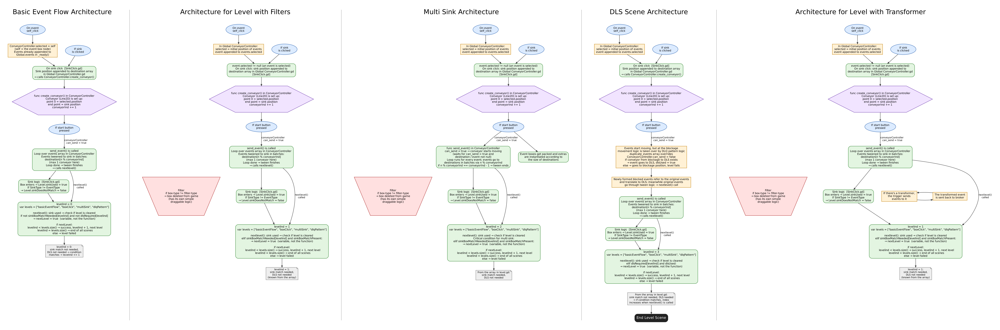
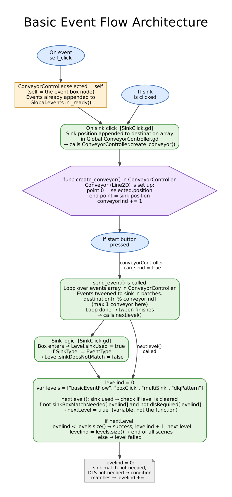
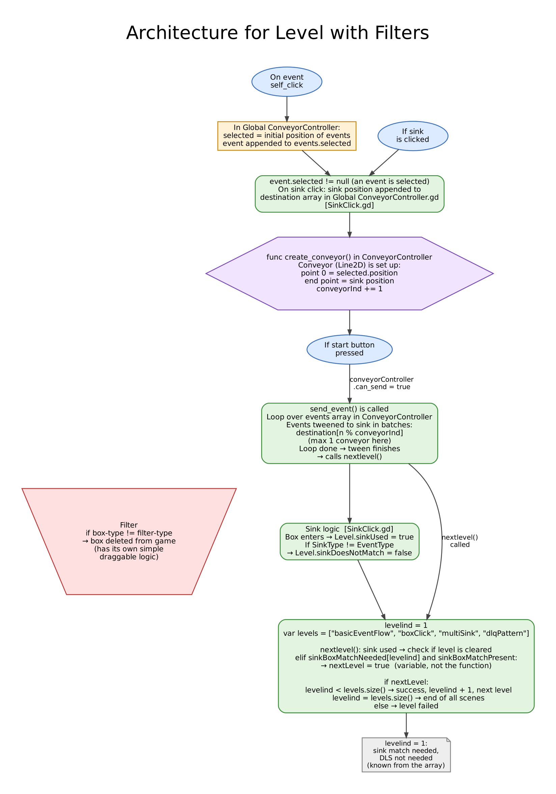
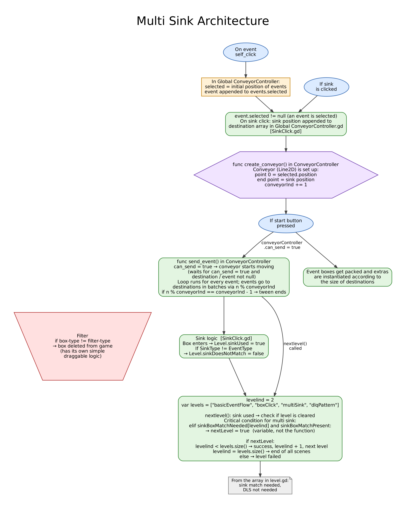
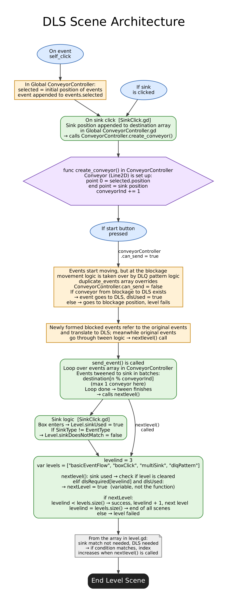
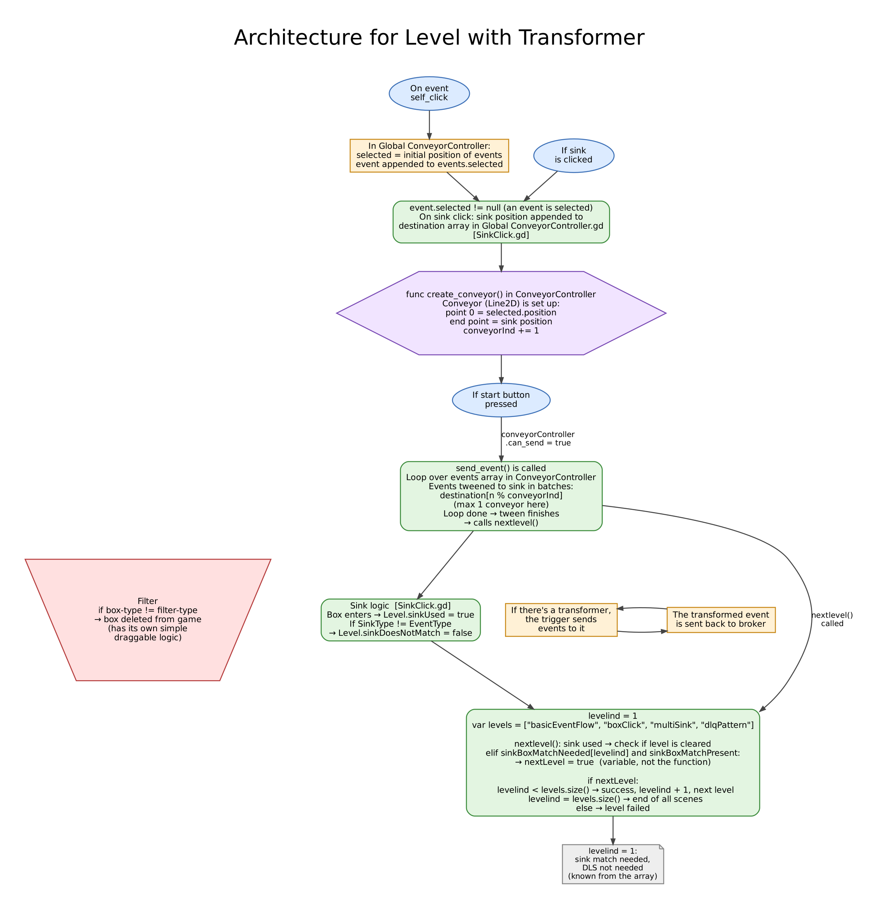

# LFX Mentorship 2026 — CNCF / Knative Educational Game

**Contributor:** Naveen Kumar Yogi ([@iwdie](https://github.com/iwdie))
**Project:** [knative-extensions/educational-game](https://github.com/knative-extensions/educational-game) — a Godot game that teaches Knative Eventing and Event-Driven Architecture patterns through gameplay.
**Contributing since:** February 2025 · **PRs:** 19 opened (10 merged) · **Issues:** 8 opened

> Work in progress — this document is updated as the mentorship continues.

---

## Contents

1. [Technical summary](#technical-summary)
2. [Contributions](#contributions)
3. [Game architecture](#game-architecture)
4. [Issues reported](#issues-reported)

---

## Technical summary

- **Event-flow architecture:** moved event duplication and sink-routing logic into `Broker.gd`, with support for Multi-Sink and Dead Letter Sink (DLS) behaviour.
- **Knative Eventing patterns:** implemented levels for **Transformation, Sequence, Multi-Sink, DataRef / Claim Check, Dead Letter Sink and Outbox**.
- **Level logic:** redesigned completion so each level decides and signals its own success instead of relying on fixed level indices.
- **Reusable scenes:** turned events, sources, sinks, conveyors and filters into reusable Godot scenes (prefabs) to cut duplicated logic across levels.
- **Bug fixing:** wrong level-success detection, duplicate conveyor creation, out-of-index errors, infinite event generation, inconsistent Multi-Sink results, DLQ blockage misplacement.
- **Presentation:** display settings, resolution, object spacing, hover labels, animations, sound effects and end-level scene.
- **Web deployment:** set up and tested the Godot web export so all levels run in the browser.
- **Integration:** regularly rebased Sequence, Multi-Sink, DataRef and Outbox work onto upstream and fixed resulting regressions.

---

## Contributions

### Merged

| PR | Date | Contribution |
|---|---|---|
| [#129](https://github.com/knative-extensions/educational-game/pull/129) | May 2026 | Multi-Sink and DLS levels |
| [#126](https://github.com/knative-extensions/educational-game/pull/126) | Apr 2026 | Transformer level |
| [#125](https://github.com/knative-extensions/educational-game/pull/125) | Apr 2026 | Broker implementation |
| [#106](https://github.com/knative-extensions/educational-game/pull/106) | Mar 2026 | `SinkClick.gd` fix (duplicate conveyors on repeated sink clicks) |
| [#102](https://github.com/knative-extensions/educational-game/pull/102) | Mar 2026 | Replaced local draggable filter with a reusable saved scene |
| [#99](https://github.com/knative-extensions/educational-game/pull/99) | Feb 2026 | Updated Godot download links in README |
| [#71](https://github.com/knative-extensions/educational-game/pull/71) | Jan 2026 | Hover label reimplementation |
| [#51](https://github.com/knative-extensions/educational-game/pull/51) | Nov 2025 | Kuack and confetti assets, end-level scene improvements |
| [#50](https://github.com/knative-extensions/educational-game/pull/50) | Oct 2025 | Fixed SFX audio files (unsupported WAV format) |
| [#47](https://github.com/knative-extensions/educational-game/pull/47) | Oct 2025 | DLQ scene bug fix |

### Open / in review

| PR | Date | Contribution |
|---|---|---|
| [#131](https://github.com/knative-extensions/educational-game/pull/131) | May 2026 | Stop `ConveyorController` processing during level transitions |
| [#130](https://github.com/knative-extensions/educational-game/pull/130) | May 2026 | DataRef / Claim Check level |
| [#128](https://github.com/knative-extensions/educational-game/pull/128) | Apr 2026 | Sequence pattern level |
| [#127](https://github.com/knative-extensions/educational-game/pull/127) | Apr 2026 | Display settings |
| [#104](https://github.com/knative-extensions/educational-game/pull/104) | Mar 2026 | `Broker.gd` logic |
| [#19](https://github.com/knative-extensions/educational-game/pull/19) | Feb 2025 | Prefabs for events, sources, sinks and conveyors; random event source |

Full list: [PRs by @iwdie](https://github.com/knative-extensions/educational-game/pulls?q=is%3Apr+author%3Aiwdie)

---

## Game architecture

These diagrams document the level flow as mapped out during the mentorship (from the FigJam board *Knative Eventing Game Architecture*). They show the `ConveyorController`-based flow that the later `Broker.gd` refactor builds on.

### Shared flow

Every level follows the same core loop:

1. **Select an event** — clicking an event box sets it as `ConveyorController.selected`.
2. **Click a sink** — `SinkClick.gd` appends the sink position to the `destination` array.
3. **Create a conveyor** — `create_conveyor()` builds a `Line2D` from the selected event to the sink and increments `conveyorInd`.
4. **Press Start** — `can_send = true`; `send_event()` tweens events to `destination[n % conveyorInd]` in batches.
5. **Sink logic** — on arrival, sets `Level.sinkUsed` and checks whether `SinkType` matches `EventType`.
6. **`nextlevel()`** — checks the level's success condition, then advances, ends the game, or fails the level.

```gdscript
var levels = ["basicEventFlow", "boxClick", "multiSink", "dlqPattern"]
```

| `levelind` | Level | Success condition |
|---|---|---|
| 0 | Basic Event Flow | `not sinkBoxMatchNeeded and not dlsRequired` |
| 1 | Filters / Transformer | `sinkBoxMatchNeeded and sinkBoxMatchPresent` |
| 2 | Multi-Sink | `sinkBoxMatchNeeded and sinkBoxMatchPresent` |
| 3 | Dead Letter Sink | `dlsRequired and dlsUsed` |

### Overview



### 1. Basic Event Flow

The simplest path: event → conveyor → sink. No sink-type match or DLS needed.



### 2. Level with Filters

Adds a draggable filter: any box whose type doesn't match the filter type is removed from the game. The sink type must match.



### 3. Multi-Sink

Event boxes are packed and extra copies are instantiated to match the number of destinations, so one source fans out to several sinks.



### 4. Dead Letter Sink (DLS)

A blockage stops normal delivery. The DLQ logic takes over (`can_send = false`); if a conveyor to the DLS exists, events go there and `dlsUsed = true`, otherwise the level fails. This is the final level and leads to the end scene.



### 5. Level with Transformer

The trigger sends events to the transformer, which returns the transformed event to the broker before delivery.



---

## Issues reported

| Issue | Status | Summary |
|---|---|---|
| [#105](https://github.com/knative-extensions/educational-game/issues/105) | Closed | Multiple conveyors created when a sink is clicked repeatedly |
| [#103](https://github.com/knative-extensions/educational-game/issues/103) | Open | Multi-Sink level sometimes shows failure on success |
| [#101](https://github.com/knative-extensions/educational-game/issues/101) | Open | Inconsistent game object setup makes property changes error-prone |
| [#65](https://github.com/knative-extensions/educational-game/issues/65) | Open | Add sink availability indicator |
| [#48](https://github.com/knative-extensions/educational-game/issues/48) | Closed | Sound effects not playing (unsupported WAV format) |
| [#46](https://github.com/knative-extensions/educational-game/issues/46) | Closed | DLQ blockage misplaced after pressing Start multiple times |
| [#20](https://github.com/knative-extensions/educational-game/issues/20) | Closed | Random event source and conveyor prefab for scaling levels |
| [#14](https://github.com/knative-extensions/educational-game/issues/14) | Closed | Hover labels for game objects |
